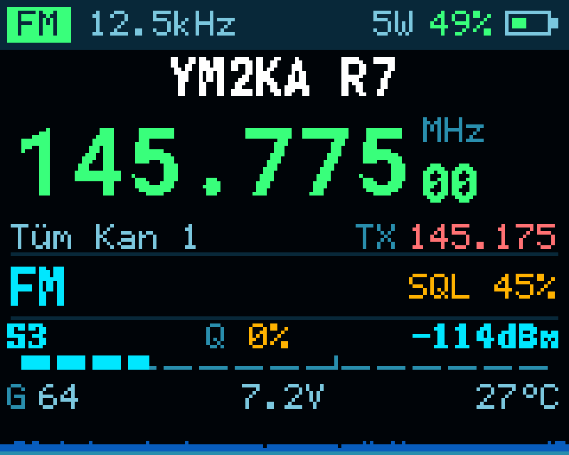
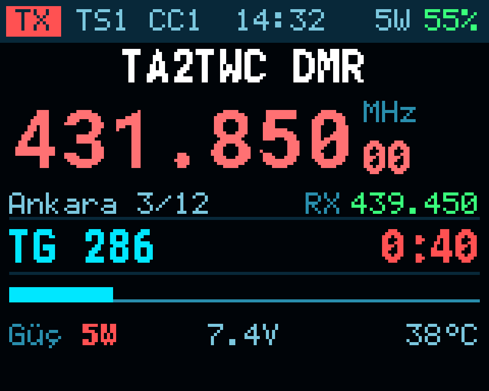
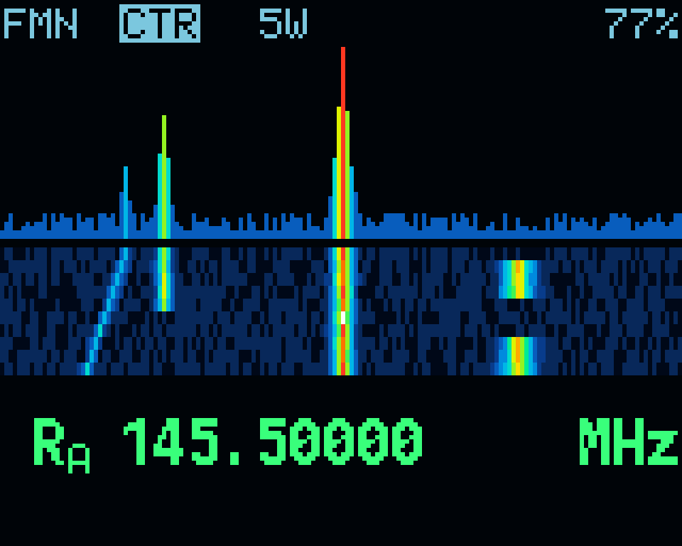
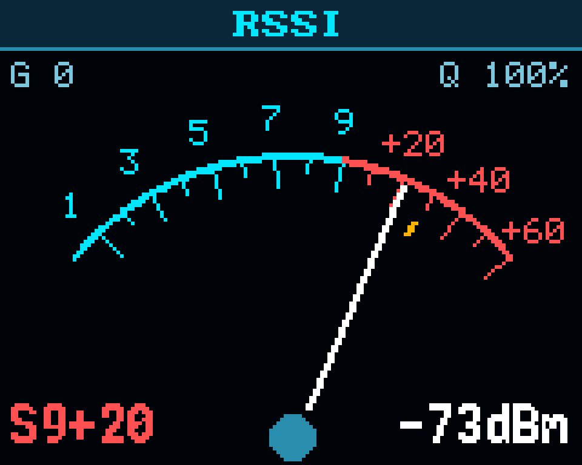
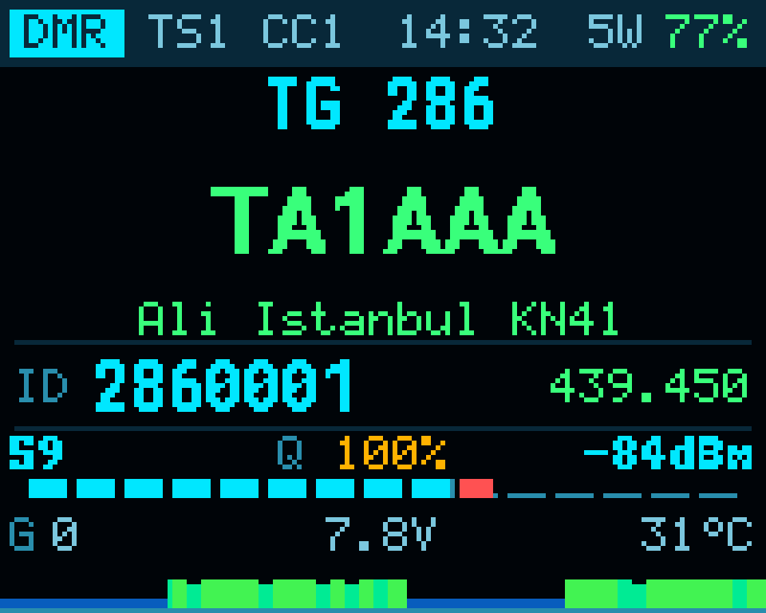
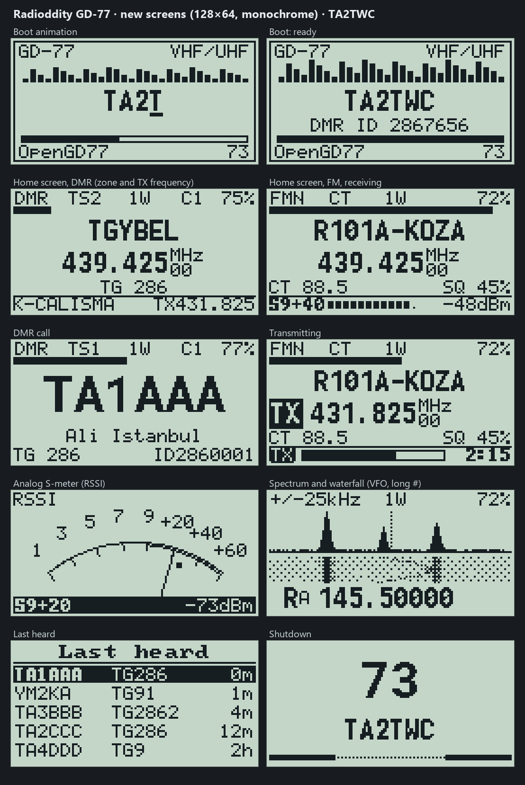

# OpenGD77 · TA2TWC screens

*Türkçe: [README.tr.md](README.tr.md)*

An unofficial build of OpenGD77 with redesigned screens. Supported radios:

- **TYT MD-UV380 / MD-UV390** (Retevis RT-3S)
- **Baofeng DM-1701** (Retevis RT-84)
- **Radioddity GD-77**

The radio side works as in OpenGD77: receive, transmit, DMR, channels and contacts. What changes is what you see on the screen, plus a few conveniences.

> **This is not the official OpenGD77.** It comes with no warranty. You install and use it at your own risk.
> Use your radio only on the frequencies and at the power levels your licence allows.



---

## Features

### TYT MD-UV380 / MD-UV390 and Baofeng DM-1701 (colour display)

| | |
|---|---|
| **New home screen** | Large frequency, channel name, zone, TX frequency and the technical values on one screen. The classic OpenGD77 screen can be selected in the menu. |
| **Signal meters** | S value, dBm, signal quality (Q %), noise, battery voltage, temperature, and a scrolling signal history. |
| **DMR caller screen** | Large callsign; name, city, DMR ID and talkgroup on their own lines. |
| **Transmit screen** | TX badge, time-out bar, microphone level in FM. |
| **Spectrum and waterfall** | Colour spectrum of the VFO sweep scan with a waterfall under it. |
| **Analog S-meter** | Needle meter with a peak mark on the RSSI screen. |
| **Boot and shutdown** | Animations showing the callsign and DMR ID stored in the radio. |
| **Other** | Battery percentage, 9-line menus, dark theme, English and Turkish texts. |

The screens were laid out again for the 160×120 display of the DM-1701.

<p>
   
</p>

### Radioddity GD-77 (128×64 monochrome display)

The same design, adapted to the small screen of the GD-77:

- boot and shutdown animations;
- channel screen with a large channel name and frequency;
- the zone on the bottom line when idle, an S-meter there while receiving;
- caller screen with the callsign in a large font;
- analog S-meter;
- waterfall under the spectrum;
- last heard list with five lines.



The program memory of the GD-77 is almost full. **GPS and hotspot mode were removed from this build** to make room for the new screens; a stock GD-77 has no GPS receiver anyway. The VFO main screen keeps the original OpenGD77 look.

The GD-77 images are drawn on a computer with the fonts of the firmware and the layout of the code (`sim/gd77_mockup.py`).

---

## Testing status

| Radio | Status |
|---|---|
| TYT MD-UV390, 5 W | In use on three radios. |
| TYT MD-UV390 Plus 10 W | Builds, **not tested**. |
| Baofeng DM-1701 | An earlier version was tested on one radio. This version is **not tested**. |
| Retevis RT-84 | Builds, **not tested**. |
| Radioddity GD-77 | Installed on one radio, the screens work. Transmit audio not confirmed yet (see the note below). |

---

## About the DMR codec

DMR needs the AMBE voice codec, which is licensed software.

- **The codec is not in this repository, and the build does not put it in the firmware files.**
- As with the official OpenGD77 releases, the OpenGD77 CPS adds the codec during installation. It takes it from the official manufacturer firmware (the "donor") that you download yourself.

Do not share firmware files that contain the codec (for example those in a local `release/` folder) or backups read from a radio.

---

## Installation

The easiest way is the firmware loader of the OpenGD77 CPS: **Extras → Firmware loader**. A step-by-step guide in Turkish is in
[docs/OpenMDUV390_TA2TWC_Kurulum_Kilavuzu.pdf](docs/OpenMDUV390_TA2TWC_Kurulum_Kilavuzu.pdf).

The donor file depends on the radio:

- **MD-UV380/390 and DM-1701:** the official TYT MD-9600 firmware, `MD9600-CSV(2571V5)-V26.45.bin`.
- **GD-77:** the official Radioddity GD-77 firmware, v4.3.6.

The CPS checks the donor file by its content and refuses a wrong file.

Always take a backup first. With it, you can always go back to the previous firmware.

---

## Building

On Windows, with Python 3.

### MD-UV380 / MD-UV390 / DM-1701

Requires the [Arm GNU Toolchain](https://developer.arm.com/downloads/-/arm-gnu-toolchain-downloads) (arm-none-eabi, tested with 14.2).

```
python build.py                         # MD-UV380 / MD-UV390 (5 W)
python build.py -c MDUV380_10W_PLUS_FW  # MD-UV390 Plus 10 W
python build.py -c DM1701_FW            # Baofeng DM-1701
python build.py -c RT84_FW              # Retevis RT-84
python tools/make_release.py            # package without the codec, for the CPS firmware loader
```

### GD-77

The OpenGD77 MK22 sources ask for the compiler of **MCUXpresso v24.12 or older**; newer ones break the transmit audio. This repository builds them without the IDE:

- compiler: Arm GNU Toolchain **13.2.rel1**;
- C library: newlib-nano (the Redlib library of MCUXpresso is not distributed outside the IDE).

```
python tools/build_gd77.py
```

> **GD-77 note:** this build differs from the official OpenGD77 build environment. Test DMR and FM transmit audio before relying on it.

---

## Folders

| Folder | Content |
|---|---|
| `MDUV380_firmware/` | Firmware sources for the MD-UV380/390, DM-1701 and RT-84 (OpenGD77 R20260131 + new screens) |
| `GD77_firmware/` | Firmware sources for the GD-77 (OpenGD77 MK22 R20260131 + new screens) |
| `tools/` | Build, packaging, backup, screenshot, satellite list, location and theme tools |
| `sim/` | Tools to preview the screens on a computer |
| `docs/` | Guide and brochure (Turkish), images, channel list of Turkey |
| `data/` | Sources of the Turkish repeater list (DARD81) and of the satellite list |
| `upstream/` | Unmodified official OpenGD77 files |

---

## License and credits

This project is built on [OpenGD77](https://www.opengd77.com):

- by Roger Clark VK3KYY, Daniel Caujolle-Bert F1RMB, Kai DG4KLU, Colin G4EML, Alex DL4LEX and contributors;
- the original OpenGD77 readme is kept in [README_OpenGD77.md](README_OpenGD77.md).

The OpenGD77 license ([license.txt](license.txt)) allows modification and redistribution, but **forbids commercial use**: the firmware may not be sold, and no radio may be charged more for having it installed. The copyright notices in the source files must be kept.

New screens and tools: Copyright (C) 2026 TA2TWC, under the same license.

73 · **TA2TWC**
